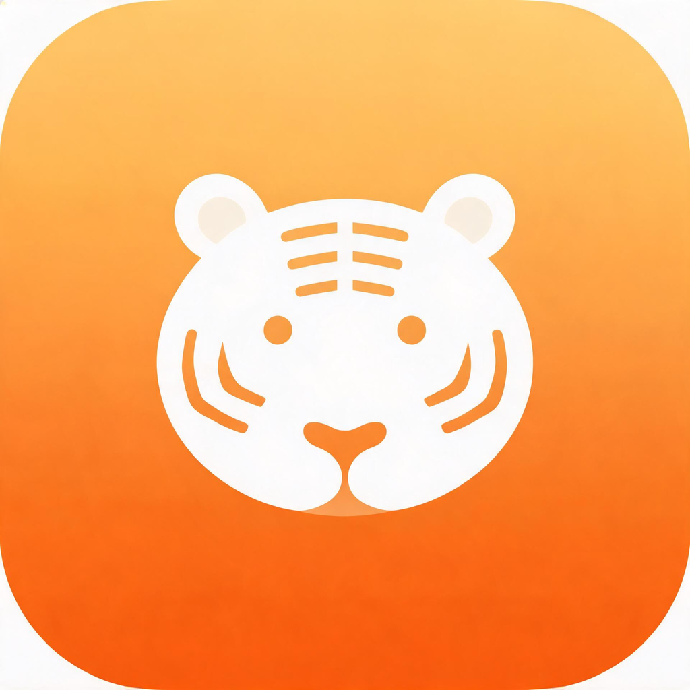
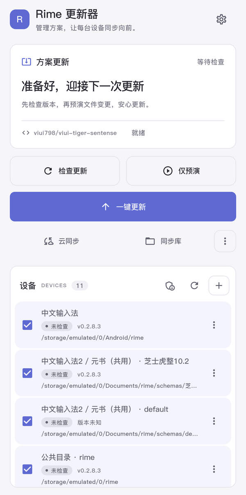
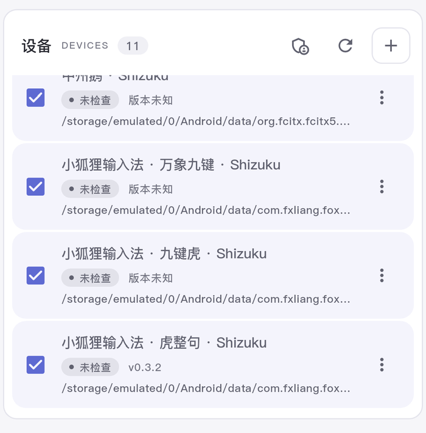

<p align="center">
  
</p>

<h1 align="center">Rime 更新器</h1>

<p align="center"><b>管理方案，让每台设备同步向前。</b></p>
<p align="center">检查版本、预演变更、更新与回滚，再把个人数据放进自己的同步库。<br>支持 macOS、Windows 与 Android，另提供 iPhone / iPad 的 Scripting 脚本。</p>

<p align="center">
  <a href="https://github.com/viui798/rime-updater/releases"></a>
  <a href="https://github.com/viui798/rime-updater/actions/workflows/build.yml"></a>
  <a href="LICENSE"></a>
  
</p>

<p align="center">
  <a href="#download">下载安装</a> · <a href="#features">全部功能</a> · <a href="#android">Android 与 Shizuku</a> · <a href="#ios">iOS 脚本</a> · <a href="#faq">常见问题</a> · <a href="#build">源码构建</a>
</p>

<br>

<h3 align="center">先看会改什么，再决定更新</h3>

<p align="center">打开应用只做本地识别。勾选目录，检查版本，再用「仅预演」查看文件变化。<br>正式更新时优先使用增量包，保留个人词典与开关记忆；开启快照后可以回滚。</p>

<p align="center">
  
</p>

<br>

<a id="download"></a>
<h3 align="center">下载 Rime 更新器</h3>

<p align="center">桌面端下载 DMG / ZIP，Android 按 CPU 架构选择 APK；iOS 通过 Scripting 导入脚本。</p>

<p align="center">
  <a href="https://github.com/viui798/rime-updater/releases"></a>
  <a href="ios/scripting/cheese-tiger-updater/README.md"></a>
</p>

<p align="center"><sub>以 Release 附件为准；尚未发布的开发版本可从源码构建。首次使用先安装并启动对应的 Rime 输入法。</sub></p>

<br>

<h3 align="center">一个工具，管理多个前端与多个方案</h3>

<p align="center">自动发现常见 Rime 目录，也能手动添加、命名、隐藏与重新识别。<br>Android 可通过 Shizuku 访问支持的 Android/data 目录，小狐狸等多方案容器按实际方案分别列出。</p>

<p align="center">
  
</p>

<br>

<h3 align="center">换方案，也带上自己的词典</h3>

<p align="center">默认对接芝士虎整，也可以选择其他 GitHub Release 方案包或本地 ZIP。<br>换方案向导负责备份个人数据、清理旧运行文件、安装新方案，再补回个人数据。</p>

<br>

<h3 align="center">个人数据，放在自己的云端</h3>

<p align="center">连接自己的 WebDAV，上传与下载个人词典、配置补丁和统计文件。<br>同步库支持目录浏览、单文件上传、云端文本编辑与删除，用户词典数据库按整组管理。</p>

<br>

<h3 align="center">电脑与手机，都有合适的布局</h3>

<p align="center">Flutter 客户端采用「静序」界面：雾白与淡紫、跟随系统的明暗主题、深色运行日志。<br>桌面使用侧栏与双栏布局，手机使用单页滚动；iOS 脚本另有主页与功能子页面。</p>

<br>

<a id="features"></a>

## 可以做什么

**Rime 更新器是通用的 Rime 方案文件管理工具。** 默认方案源为 [芝士虎整](https://github.com/viui798/viui-tiger-sentense)，可以改用其他仓库的 Release ZIP 或本地方案包。它负责下载、文件比对、安装、备份和同步；输入法引擎与方案编译仍由各 Rime 前端提供。

### 方案更新与安装

| 功能 | 说明 |
| --- | --- |
| 检查版本 | 显示本地版本、远端版本、所选安装包与更新状态 |
| 启动不自动联网 | 启动只识别本地目录；手动检查后缓存 Release 信息 10 分钟，供预演与更新复用 |
| 增量优先 | 优先选择 `*-update.zip`；没有增量包或包标记 `full_required` 时改用完整包 |
| 下载缓存与校验 | 默认更新流程在 Release 提供同名 `.sha256` 时校验 SHA256；缓存按校验值复用，无校验值时按资产大小判断 |
| 仅预演 | 下载、解包并比对变化，展示将更新的文件及删除计划，不改写目标方案文件；会使用下载缓存与临时目录 |
| 多目录更新 | 勾选多个目录，按顺序安装，同一时间只运行一个操作任务 |
| 跳过未变化文件 | 文件内容一致时跳过复制，减少重复写入与快照 |
| 增量删除 | Flutter / Python 客户端处理 `DELTA.json` 删除列表，同样遵守个人数据保护规则 |
| GitHub 方案 | 输入 `owner/repo` 或 GitHub 仓库网址，读取最新 Release，选择其中的 ZIP 资产安装 |
| 本地 ZIP | 系统文件选择器导入；识别扁平包、`update/` 前缀与单层包装目录，优先从包内信息、其次从文件名推断版本 |
| 换方案向导 | 从本地 ZIP 或当前配置仓库换方案：备份 → 清理旧方案运行文件 → 安装 → 补回缺失的个人数据 → 部署 |
| 状态与日志 | 显示设备数量、版本、备份、操作进度、逐文件日志与错误信息 |
| 更新设置 | 可配置默认仓库、GitHub Token、HTTP 代理、缓存目录、更新后部署、重启前端与快照开关 |

GitHub 仓库需要提供可安装的 **Release ZIP 资产**。源码仓库地址本身不等于适配完成的方案包；不同方案依赖的 Rime / Lua 版本、词典和模型应由方案作者说明。主更新流程的 SHA256 校验不代表每个入口都会自动校验；「GitHub 方案」临时选包和 Flutter 本地 ZIP 入口目前没有同等的自动旁文件校验流程。

### 个人数据保护、备份与回滚

- **方案更新跳过个人数据**：包括 `*.userdb`、`*.options.yaml`、`user.yaml`、`installation.yaml`、`reverse_freq.txt`、`custom_phrase.txt`、`build/`、`sync/`，以及 `lua/kc_count.txt`、`lua/kc_total.txt`、`lua/input_stats_*.lua` 等统计文件。日志、说明文档与打包工具等也不作为方案文件覆盖。
- **自定义补丁覆盖前备份**：已有 `*.custom.yaml` 并非一律跳过；需要覆盖时，会先保存旧文件。
- **更新快照**：图形客户端默认开启。快照清单记录旧版本、覆盖文件、新增文件与删除文件；可在「备份与回滚」查看、回滚和清理。
- **回滚**：恢复已备份的旧文件、移除该次新增文件、恢复版本标记，并按设置执行部署。
- **大文件上限**：单文件超过 **32 MiB** 时只记录、不复制进更新快照，因此这些文件不能依靠快照完整恢复。特定大模型 `models/sentence-fivegram-mobile.bin` 在目标已有同尺寸文件时跳过复制。
- **换方案备份**：清理 `lua/`、`opencc/`、`models/`、`dicts/` 等旧运行目录及根目录旧方案 YAML 前，单独收集个人数据；安装后只补回缺失的个人数据。
- **同步前备份**：下载云端文件前先备份本机个人数据，存入应用数据目录下的 `switch-backups/`。这类备份与更新快照分开存放，不是都能从更新快照列表一键回滚。
- **独立 ZIP 备份工具**：附带 `backup_userdata.py`，可列出、导出和恢复个人数据，详见[命令行与备用界面](#cli)。

安装成功后以 `.cheese-tiger-version` 保存版本，不把版本号写进 `user.yaml`。历史路径和文件名中的 `cheese-tiger` 保留用于数据兼容。

### 设备与目录管理

- 自动发现受支持的本机前端目录，显示名称、实际路径和已记录版本；可刷新重新识别。
- 桌面端通过「+」选择目录；Android 可填写公共目录路径。手动目录会持久保存，并支持改名。
- 行末「⋮ → 删除设备」只移除列表项，**不会删除任何输入法文件**。自动目录会记为隐藏，用「+」重新添加即可恢复。
- 共享路径去重，多方案容器识别其中含 Rime 配置的实际方案目录，避免安装到容器根目录。
- 「设备」表示本机的一份 Rime 用户 / 方案目录，不表示可以远程控制另一台电脑；跨设备传输通过 WebDAV 完成。

### WebDAV 云同步与同步库

在「云同步」配置服务器地址、用户名、密码 / 应用密码及本机名称，再选择目标目录。

| 功能 | 说明 |
| --- | --- |
| 上传本机 | 按个人数据白名单上传自造词、调频、开关记忆、自定义补丁、统计与用户词典等 |
| 添加文件 | 从选定设备目录内选择一个文件，单独加入同步库 |
| 下载云端 | 先备份本机个人数据，再把同步库文件写回本机；按设置部署 |
| 文件来源 | 清单记录上传设备、设备名称与更新时间 |
| 删除云端文件 | 只删云端那份，不删除本机文件；`*.userdb` 合并显示并整组删除 |
| 同步库浏览 | 根层按前端分组，进入后按文件夹层级浏览 |
| 在线文本编辑 | 查看、编辑并保存 YAML / TXT / Lua / JSON / Markdown 等云端文本，更新清单时间；二进制与用户词典不在线编辑 |
| 中文与二进制 | 路径逐段编码；用户词典目录展开为具体文件传输 |

云端结构为：

```text
CheeseTigerSync/
└── <kind>/
    ├── manifest.json
    └── files/
        └── <相对路径>
```

使用 `MKCOL / PUT / GET / DELETE`，无需服务端提供 `PROPFIND` 列表能力。可对接兼容这些操作的 WebDAV 服务，如坚果云、Nextcloud；当前已完成本地模拟服务测试，真实服务账号仍需实测。

同步库按前端类型 `kind` 分组。同一种类型共用文件库，**不同类型不会自动合并，也不转换不同 Rime 版本的词典数据库格式**。当前是手动上传 / 下载，未提供后台自动同步、冲突合并或跨端数据库兼容保证。

### 平台支持一览

| 功能 | macOS / Windows Flutter | Android Flutter | iOS Scripting |
| --- | --- | --- | --- |
| 检查 / 预演 / 更新 | 支持 | 支持，受目录权限限制 | 支持，待真机验证 |
| GitHub 选包 / 本地 ZIP / 换方案 | 支持 | 支持 | 支持 |
| 快照 / 回滚 / 删除快照 | 支持 | 支持 | 支持 |
| 多目录 | 自动探测 + 手动添加 | 公共路径 + Shizuku | 系统选目录、书签保存 |
| 部署 | 按前端调用，部分需手动 | 更新后在输入法内手动部署 | URL scheme 请求或手动 |
| WebDAV 批量上传 / 下载 / 删除 | 支持 | 支持 | 支持 |
| 同步库单文件上传 / 在线编辑 | 支持 | 支持；系统选择器有路径限制 | 暂不支持 |
| 增量删除列表 | 支持 | 支持 | 暂不执行 |

## 安装

先安装并运行目标 Rime 输入法，使其创建用户目录，再安装更新器。更新器本身不附带输入法引擎。

### macOS

1. 从 [Releases](https://github.com/viui798/rime-updater/releases) 下载 macOS DMG。
2. 打开 DMG，把 `RimeUpdater.app` 拖入「应用程序」。
3. 首次打开未签名 / 未公证版本时，如系统拦截，在「系统设置 → 隐私与安全性」中允许打开。
4. 勾选目录 →「检查更新」→「仅预演」→ 确认后「一键更新」。

### Windows

1. 下载 Windows ZIP 并完整解压。
2. 运行 `rime_updater.exe`，保留旁边的 DLL、`data/` 等文件。
3. 勾选小狼毫、虎韵或手动目录，按同样流程检查、预演与更新。

### 桌面前端与部署

| 平台 / 前端 | 默认识别位置 | 部署方式 |
| --- | --- | --- |
| macOS 鼠须管 | `~/Library/Rime` | `Squirrel --reload`，必要时回退 `rime_deployer --build` |
| macOS 小企鹅 Fcitx5 | `~/.local/share/fcitx5/rime` | 尝试 `fcitx5-curl` 部署接口；以输入法实际重建结果为准，必要时手动部署 |
| macOS 元书 Cobra | `~/Library/Application Support/com.ihsiao.inputmethod.Cobra/RimeUserData` | 手动部署，或在设置开启重启前端 |
| Windows 小狼毫 | 优先读取注册表 `RimeUserDir`，否则 `%APPDATA%\Rime` | 退出服务 → `WeaselDeployer /deploy` → 拉起服务 |
| Windows 虎韵 | `%LOCALAPPDATA%\Tigrime\Rime` | `Tigrime.Deployer.exe` 完成停服务、重建与恢复服务 |
| Windows 其他目录 | 在 `%APPDATA%` / `%LOCALAPPDATA%` 中有限深度扫描含 `tiger*.schema.yaml` 的目录，或手动添加 | 未适配的前端需手动部署 |

部署会异步运行并显示日志。小企鹅的接口返回不等于部署一定完成；若候选未恢复，请从输入法自身触发重新部署。

<a id="android"></a>

### Android 与 Shizuku

当前构建适用于 **Android 7.0 / API 24 及以上**；不同系统对目录访问的限制不同。按设备架构选择 APK：

| 架构 | 适用设备 | 本地 build 3 大小，约 |
| --- | --- | --- |
| `arm64-v8a` | 大多数现代 Android 手机 | 18.9 MB |
| `armeabi-v7a` | 32 位 ARM 设备 | 16.7 MB |
| `x86_64` | x86_64 模拟器或设备 | 20.3 MB |

分架构 APK 只包含一种 CPU 的原生库，因此小于通用 APK。附件名称以实际发布为准；当前 CI 默认仍生成通用 `app-release.apk`，分架构构建命令见[源码构建](#build)。

1. 安装 APK，按系统提示授予「所有文件访问权限」，返回应用后重新识别。
2. 公共目录直接勾选；自定义公共目录点设备区「+」输入路径。
3. 若目标位于支持的 `Android/data` 目录，先安装并启动 [Shizuku](https://github.com/RikkaApps/Shizuku)，再点设备区 **盾牌 → 连接 Shizuku**，在授权窗口允许更新器。
4. 刷新列表，确认实际方案目录后检查、预演与更新。完成后在对应输入法中**手动重新部署**。

已接入的典型路径：

| 输入法 / 目录类型 | 路径或规则 | 访问方式 |
| --- | --- | --- |
| 同文及公共目录 | `/storage/emulated/0/rime`，以及部分以前端命名的公共目录 | 所有文件访问权限 |
| 中文输入法 | `/sdcard/Android/rime`，规范化为 `/storage/emulated/0/Android/rime` | 公共目录检测；是否可读以系统为准 |
| 中文输入法2 / 元书 | `/storage/emulated/0/Documents/rime`；存在 `schemas/<方案名>` 时按方案分别列出 | 公共目录，共用路径只显示一次 |
| 同文及分支 | `Android/data/<包名>/files/rime` 等实际存在的目录 | Shizuku |
| 小企鹅 / 中州鹅 | `Android/data/org.fcitx.fcitx5.android.fx.rime/files/data/rime` | Shizuku |
| 小狐狸 | `Android/data/com.fxliang.foxy/files/foxy/rime/<方案名>` | Shizuku，多方案分别识别 |

**Shizuku 的范围**：普通无线调试启动的 Shizuku 使用 ADB shell 权限，不能因此读取其他应用的 `/data/user/0` 内部私有目录。仓、虎标等前端若将数据放在内部目录，需要先使用其公共目录设置或导入 / 导出功能；已安装输入法不代表已有可管理目录。

受限目录操作会先读取到更新器缓存，跳过 `build/`，然后运行预演、更新、本地 ZIP、换方案、回滚或 WebDAV 批量操作。正式写回只提交变化文件，先核对原文件 SHA256；发现目标被改动会停止。普通提交错误会尝试恢复，恢复失败保留 `.rime-updater-txn-*` 救援目录，并阻止继续提交。暂存需要预留与读取目录规模相近的可用空间。

系统单文件选择器仍受 Android 限制，不能因为授予 Shizuku 就任意浏览受限路径；这类目录优先使用「上传本机」批量同步。更新器不会自动停止或部署 Android 输入法。

<a id="ios"></a>

### iOS / iPadOS：Scripting 脚本

iOS 当前使用独立的 **Scripting 脚本**，不是可安装的 Flutter iOS 成品。无需自己准备 Apple 开发者账号，但需要先安装支持目录书签与解压 API 的 [Scripting](https://scripting.fuqiuluo.com/)。

在 Scripting 中添加远程脚本，导入：

```text
https://github.com/viui798/rime-updater/tree/main/ios/scripting/cheese-tiger-updater
```

脚本提供：

- 检查、预演、一键更新全部目录，或只安装到某一个目录。
- 任意 GitHub 仓库、Release ZIP 选择、本地 ZIP、换方案。
- 多目录书签、命名 / 重命名、设为当前、移除与每目录部署方式。
- 快照列表、回滚、删除，以及 WebDAV 批量上传、下载、刷新与云端删除。
- 仓输入法 `hamster://`、元书 `hamster3://` 部署请求，或手动部署。
- 主页及云同步 / 备份 / 换方案 / 设置 / 日志子页面，可清空日志；WebDAV 密码存入 Keychain。
- 通过 Scripting 的远程资源配置每 24 小时检查脚本自身更新。

**当前限制**：尚未真机验证；不处理 `DELTA.json` 删除列表；版本保存在脚本本地存储；云端暂不提供单文件上传与文本在线编辑。脚本使用 `hamster` / `hamster3` / `manual` 同步分组，和桌面端其他类型的同步库不会自动合并。安装与使用细节见 [iOS 脚本说明](ios/scripting/cheese-tiger-updater/README.md)。

## 数据与权限

更新器读取你选择的 Rime 目录，正式更新、回滚、换方案或下载同步库时会写入该目录。远端方案检查与下载访问配置的 GitHub 仓库；云同步把所选文件发送到你填写的 WebDAV 服务。

| 数据 | macOS | Windows | Android |
| --- | --- | --- | --- |
| 设置文件 | `~/Library/Application Support/CheeseTigerUpdater/settings.json` | `%LOCALAPPDATA%\cheese-tiger\updater-settings.json` | 应用私有 `files/cheese-tiger/updater-settings.json` |
| 同步设备标识 | 设置文件同目录的 `sync-state.json` | 同左 | 同左 |
| 下载缓存 | `~/Library/Caches/cheese-tiger` | `%LOCALAPPDATA%\cheese-tiger\cache` | 应用私有缓存下的 `cheese-tiger/` |
| 换方案 / 同步前备份 | 设置文件同目录的 `switch-backups/` | 同左 | 同左 |
| 更新快照 | 目标 Rime 目录下 `.cheese-tiger-backup/<时间戳>/` | 同左 | 同左，受限目录通过 Shizuku 访问 |
| 版本标记 | 目标 Rime 目录下 `.cheese-tiger-version` | 同左 | 同左 |

Flutter 的设置文件以 **JSON 明文**保存 GitHub Token 和 WebDAV 凭据，并未使用系统钥匙串。分享日志、设置文件或提交 Issue 前，请删除 Token、密码、账号与个人路径。iOS 脚本的 WebDAV 密码另存于 Scripting Keychain。

Android 的「所有文件访问权限」用于公共方案目录，Shizuku 授权用于支持的受限目录；普通公共路径不要求连接 Shizuku。支持局域网 HTTP WebDAV，也可使用 HTTPS 地址；HTTP 不加密账号和传输内容。

macOS 客户端关闭了 App Sandbox 以访问外部 Rime 目录。备份、设置和缓存不随 Git 仓库同步；卸载 Android 应用会移除其私有设置、缓存及其中的个人数据备份，换机前应另行导出需要保留的内容。

## 使用边界与验证状态

- 方案包是否完整、能否在目标前端部署，取决于方案本身与输入法环境；更新器不安装 Rime 引擎、不生成 Release 包、不自动转换方案或词典格式。
- 增量回退依赖包内的 `full_required` 标记。**仅包含相邻版本变化的增量包可能补不齐很旧基线缺失的文件**；不能仅凭版本号就保证文件齐全，跨较多版本或部署报缺文件时应使用完整包。
- 快照受 32 MiB 单文件上限限制；正式操作前建议先预演，重要数据另行备份。换方案会清理旧运行文件，请确认目标确为方案目录。
- Flutter 客户端尚无自身自动升级机制。当前 macOS 构建未签名 / 公证，Android release 仍使用测试签名，主要面向自行分发与测试。

截至 **2026-11-05** 的验证记录：

| 项目 | 已验证 | 仍待验证 |
| --- | --- | --- |
| 自动化验证 | 静态分析无问题，41 项 Flutter 测试通过；6 项 Android 隔离原生测试通过 | 新增场景随版本继续补充 |
| macOS | 三前端识别、检查与预演；历史 Python 实现跑过实际更新 | Flutter 界面完整更新 / 回滚；各前端部署结果 |
| Windows | 小狼毫 / 虎韵实机更新、快照与部署 | 界面回滚后的输入效果 |
| Android | 模拟器公共目录检查 / 预演 / 更新 / 快照；真机安装、Shizuku 授权及 11 个实际方案目录识别 | 真机受限目录正式写回、回滚与输入法部署 |
| WebDAV | 本地 HTTP 模拟服务覆盖上传、下载、删除、中文路径与编辑 | 真实 WebDAV 账号和跨设备实测 |
| iOS Scripting | 脚本语法检查 | iPhone / iPad 完整流程 |

<a id="faq"></a>

## 常见问题

<details>
<summary><b>只能更新芝士虎整吗？</b></summary>

不是。默认仓库是芝士虎整，但可在设置里更换默认仓库，或通过「GitHub 方案」「本地 ZIP」使用其他方案包。选择可安装的 Rime 方案 ZIP；首次更换为另一套方案时使用「换方案」向导，而非直接混入旧文件。

</details>

<details>
<summary><b>为什么打开后不显示最新版本？需要 Token 吗？</b></summary>

启动故意不自动请求 GitHub，点击「检查更新」才会联网。公共仓库通常不需要 Token；频繁检查遇到限流时可在设置填写 Token。检查结果缓存 10 分钟，预演和更新复用。Flutter 网络代理目前支持 HTTP，不支持 SOCKS5；可填写代理软件提供的 HTTP 端口。

</details>

<details>
<summary><b>为什么我装了输入法，列表仍识别不到？</b></summary>

先打开输入法并完成初始化，确认它的实际 Rime 用户目录。桌面可手动添加；Android 公共目录需授予文件权限，支持的 `Android/data` 目录需启动并授权 Shizuku。内部 `/data/user/0` 私有目录不在普通 Shizuku 的可访问范围内。多方案前端要添加实际方案目录，共用路径只显示一份。

</details>

<details>
<summary><b>Android 包应该选哪个？为什么以前那么大？</b></summary>

大多数现代手机选 `arm64-v8a`；32 位 ARM 设备选 `armeabi-v7a`，x86_64 模拟器选 `x86_64`。通用 APK 同时带多套 CPU 原生库，体积更大；分架构包功能相同，只保留相应架构。当前本地 ARM64 build 3 约 18.9 MB，实际发布以附件为准。

</details>

<details>
<summary><b>更新后不能输入，或者提示缺词典 / Lua 文件怎么办？</b></summary>

先检查是否选对目录，并在输入法里重新部署。Android 必须手动部署；桌面也要核对日志与实际构建结果。若旧版本缺少增量包没有携带的文件，改用完整包补齐；不要只依赖版本标记。若本次更新需要撤销，可回滚对应快照；超过快照单文件上限的内容需要自行恢复。

</details>

<details>
<summary><b>会覆盖我的词典、自定义配置吗？快照能恢复所有内容吗？</b></summary>

普通方案更新跳过用户词典、开关记忆等受保护数据。`*.custom.yaml` 可能随方案更新，覆盖前保存旧文件。快照恢复其实际备份的内容并移除本次新增文件；超过 32 MiB 的文件只记录，不保证恢复。换方案和云端下载是不同操作，会产生独立的个人数据备份。

</details>

<details>
<summary><b>云同步会自动合并电脑与手机词典吗？</b></summary>

不会自动合并。同步库按前端类型分组，手动上传 / 下载所选文件，不提供数据库格式转换、词条级冲突处理或后台实时同步。确认方案与 Rime 版本兼容后再交换用户词典；避免输入法正在写数据库时直接同步。

</details>

<details>
<summary><b>删掉「设备」或云端文件，会删除本机输入法吗？</b></summary>

删除设备只调整更新器列表；云端删除只作用于服务器。清理备份则会删除选中的本地快照，之后不能再用它回滚。删除共享云端文件也会影响其他设备后续可下载的内容。

</details>

<details>
<summary><b>Shizuku 写回报并发修改，或留下救援目录怎么办？</b></summary>

写回前会比对原文件，输入法或其他工具同时改动文件时会停止。暂停相关写入后重新读取与预演。若提示存在 `.rime-updater-txn-*`，先保留并检查救援内容、按错误信息恢复；不要直接删掉救援副本或反复提交。读取大目录还需要足够的缓存空间。

</details>

<details>
<summary><b>iOS 可以直接安装 App 吗？会自动更新自身吗？</b></summary>

当前提供的是 Scripting 脚本，按上方导入地址安装，完整流程尚待真机验证。脚本可以通过 Scripting 检查远程资源更新；这和 Flutter 客户端是两套机制，Flutter 客户端仍需手动下载新版安装包。

</details>

<a id="cli"></a>

## 命令行与备用界面

仓库保留纯 Python 标准库实现，不需要安装 pip 依赖。主要面向 macOS / Windows，不包含 Android 的 Shizuku 通道。

### 更新命令行

```bash
# 查看目录与版本
python3 update_desktop.py --list-profiles
python3 update_desktop.py --check

# 只预演
python3 update_desktop.py --dry-run --yes

# 正式更新：显式启用快照，并请求部署
python3 update_desktop.py --yes --snapshot --deploy

# 从本地方案包安装到指定目录
python3 update_desktop.py --source ./scheme-v1.2.3.zip --target /path/to/rime --snapshot --yes

# 按快照时间戳回滚
python3 update_desktop.py --rollback <时间戳> --target /path/to/rime --deploy --yes
```

| 参数 | 用途 |
| --- | --- |
| `--list-profiles` / `--check` | 列目录 / 检查远端版本 |
| `--source <ZIP或URL>` | 本地 ZIP 或直链，跳过 GitHub Release 查询 |
| `--target <目录>` | 指定目标，可重复传入 |
| `--version <tag>` | 指定远端 Release tag，默认最新；不是本地包显示版本参数 |
| `--dry-run` / `--yes` | 仅预演 / 跳过交互确认 |
| `--snapshot` | 启用更新快照；CLI 与图形界面不同，需显式添加 |
| `--rollback <时间戳>` | 从对应快照还原 |
| `--deploy` / `--restart` | 请求部署 / 重启前端 |
| `--proxy <地址>` | HTTP 代理，例如 `http://127.0.0.1:7890` |
| `--cache-dir <目录>` / `--no-cache` | 缓存目录 / 不复用缓存 |

CLI 默认使用代码中配置的方案仓库；临时安装其他来源可用 `--source`。GitHub Token 可通过 `GITHUB_TOKEN` 或 `GH_TOKEN` 环境变量传入。Python 本地 ZIP 有同名 `.sha256` 旁文件时会校验。

### 个人数据 ZIP 备份与恢复

```bash
# 查看将备份的内容
python3 backup_userdata.py --list

# 每个前端生成一个 ZIP，默认输出到 ~/Desktop/芝士虎整备份/
python3 backup_userdata.py --yes

# 恢复到指定目录
python3 backup_userdata.py --restore ./backup.zip --target /path/to/rime --yes
```

支持 `--out` 指定输出目录、重复 `--target`、`--dry-run`、`--no-userdb`。默认包含用户词典，跳过可重建的 `lua/replacer.userdb`；加 `--with-cache` 可包含它。备份包由 `userdata/` 和 `BACKUP.json` 清单组成。备份 / 恢复前建议暂停输入法写入，恢复后重新部署。

### Python 本地 Web 界面

```bash
python3 gui_app.py             # 启动本机服务并打开浏览器
python3 build_app.py           # 生成 Python 版 .app / Windows 启动器
```

服务只监听 `127.0.0.1`，默认端口 `8765`，占用时自动顺延；提供检查、预演、更新、设置、进度、日志与快照回滚。它是备用实现，**没有 Flutter 版完整的 WebDAV 同步库等新功能**。Python 打包产物依赖系统 Python 3，与 Flutter 原生安装包不同。

<a id="build"></a>

## 从源码构建

主客户端位于 `app/`。开发环境已使用 Flutter stable **3.47.9 / Dart 3.13.7** 验证；项目 Dart 约束见 [pubspec.yaml](app/pubspec.yaml)。Android 另有 Kotlin / AIDL 与 Shizuku 依赖。

### 获取代码与检查

```bash
git clone https://github.com/viui798/rime-updater.git
cd rime-updater/app
flutter pub get
dart analyze
flutter test

# 可选：真实联网下载（复用缓存），对首个识别目录执行只读预演
# 会下载包，但不正式更新方案
dart run tool/verify.dart
```

### macOS

在 macOS 安装完整 Xcode 和命令行工具后：

```bash
flutter build macos --release
./tool/make_dmg.sh 1.0.0
```

产物：`app/build/macos/Build/Products/Release/RimeUpdater.app`，DMG 为 `app/build/RimeUpdater-v1.0.0-macos.dmg`，路径均相对于仓库根目录。若默认开发工具指向 CommandLineTools，可为构建设置 `DEVELOPER_DIR` 指向实际 Xcode 的 `Contents/Developer`。

### Windows

在 Windows 安装 Flutter 和 Visual Studio「使用 C++ 的桌面开发」工作负载：

```powershell
flutter pub get
flutter build windows --release
```

分发 `app/build/windows/x64/runner/Release/` **整个目录**，入口为 `rime_updater.exe`。

### Android：按 CPU 架构打包

准备 JDK 17、Android SDK 36 及 Flutter 所需构建工具，正确设置 `JAVA_HOME` / Android SDK 路径：

```bash
flutter build apk --release --split-per-abi
```

产物位于 `app/build/app/outputs/flutter-apk/`：

```text
app-arm64-v8a-release.apk
app-armeabi-v7a-release.apk
app-x86_64-release.apk
```

需要通用包时使用 `flutter build apk --release`。Debug 使用独立应用 ID `com.viui798.rime_updater.dev`，正式版为 `com.viui798.rime_updater`。当前 release 使用 debug 测试签名；正式分发前应自行配置签名，并妥善保管密钥。不同签名的 APK 不能直接覆盖安装。

### CI 与其他入口

[GitHub Actions](.github/workflows/build.yml) 支持手动触发或推送 `v*` tag，构建 macOS DMG、Windows ZIP 和 Android 通用 APK；tag 构建成功后发布 Release。

iOS 脚本通过 Scripting 导入，原生 `app/ios/` 只是平台工程骨架，不能当作已经完成的客户端分发。修改 Python 实现后可在仓库根目录执行：

```bash
python3 -m py_compile update_desktop.py gui_app.py backup_userdata.py
```

## 目录

| 路径 | 内容 |
| --- | --- |
| `app/lib/main.dart` | 主界面、任务编排、设备与备份列表 |
| `app/lib/core/` | 目录识别、包下载与安装、快照回滚、部署、设置、WebDAV 同步 |
| `app/lib/ui/` | 主题与各功能弹窗、同步库管理器 |
| `app/android/` | Android 工程、权限与文件选择、Shizuku / AIDL 文件服务 |
| `app/macos/`、`app/windows/` | 桌面平台工程 |
| `app/test/` | Dart / Flutter 测试 |
| `app/android/app/src/androidTest/` | 隔离文件操作与目录识别原生测试 |
| `app/tool/` | 下载预演验证、DMG 打包与图标资源 |
| `ios/scripting/cheese-tiger-updater/` | iOS Scripting 脚本、功能页面与安装说明 |
| `update_desktop.py` | 纯标准库更新 CLI 与核心参照实现 |
| `backup_userdata.py` | 个人数据 ZIP 备份 / 恢复工具 |
| `gui_app.py`、`web/` | Python 本地 Web 备用界面 |
| `build_app.py` | Python 版应用打包 |
| `.github/workflows/build.yml` | 三平台构建与 Release 发布 |
| `docs/assets/` | README 使用的真机界面截图 |
| `DESIGN.md` | 视觉规范与响应式布局约定 |
| `AGENTS.md` | 开发记录、验证状态与交接说明 |
| `dist/` | 本地打包与验证产物，已忽略，不随仓库分发 |

## 参与贡献

欢迎通过 [Issues](https://github.com/viui798/rime-updater/issues) 反馈问题或提出功能建议，也欢迎提交 Pull Request。

反馈目录识别问题时，请说明系统版本、输入法名称 / 版本、实际用户目录与权限状态；更新失败时请附方案仓库、包名、操作步骤及脱敏日志。不要提交 Token、WebDAV 密码、个人词典或未经清理的设置文件。

修改前先读 [AGENTS.md](AGENTS.md)，界面修改同时参考 [DESIGN.md](DESIGN.md)。客户端改动运行静态分析与相关测试；文件覆盖、回滚及 Shizuku 写回应先在临时目录验证。

## 社区与相关项目

- [问题反馈](https://github.com/viui798/rime-updater/issues) · [版本下载](https://github.com/viui798/rime-updater/releases) · [构建记录](https://github.com/viui798/rime-updater/actions)
- [芝士虎整](https://github.com/viui798/viui-tiger-sentense)：默认方案源；方案包与增量包由该仓库的发版流程生成，本仓库负责安装。
- [Rime](https://github.com/rime)：输入法引擎与前端生态。
- [Shizuku](https://github.com/RikkaApps/Shizuku)：Android 受限目录访问所使用的授权服务。

## 授权范围与再发布

本项目按 [GPL-3.0](LICENSE) 开源。修改、再发布或商业使用时，请遵守许可证，保留适用的版权、许可与修改声明，并按要求提供对应源码。第三方组件与引用内容遵守各自许可证；更新器的许可证不代替所下载方案包的许可。

## 许可证与致谢

- [Flutter](https://github.com/flutter/flutter)：跨平台客户端框架。
- [Rime](https://github.com/rime) 及各平台前端：输入法引擎、用户目录与部署能力。
- [Shizuku](https://github.com/RikkaApps/Shizuku)：Android 授权 API 与服务。
- [BlackCCCat/Scripting-Scripts](https://github.com/BlackCCCat/Scripting-Scripts)（MIT）：iOS 脚本中的部分文件与下载兼容工具改编自该项目，详见脚本说明与源文件。
- [VoltAgent/awesome-design-md](https://github.com/VoltAgent/awesome-design-md)：界面设计文档与 Linear / Raycast 分析参考。
- [ccch1mneyyy/dsh-Go](https://github.com/ccch1mneyyy/dsh-Go)：本 README 的章节结构与展示方式参考。

<p align="center"><sub>Rime 更新器是独立工具，输入方案与部署行为以所用方案包和输入法前端为准。</sub></p>
